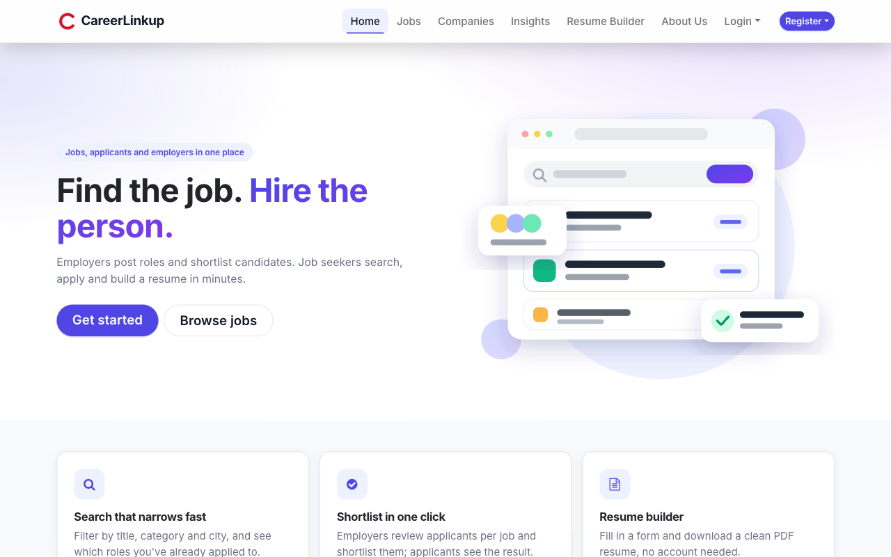
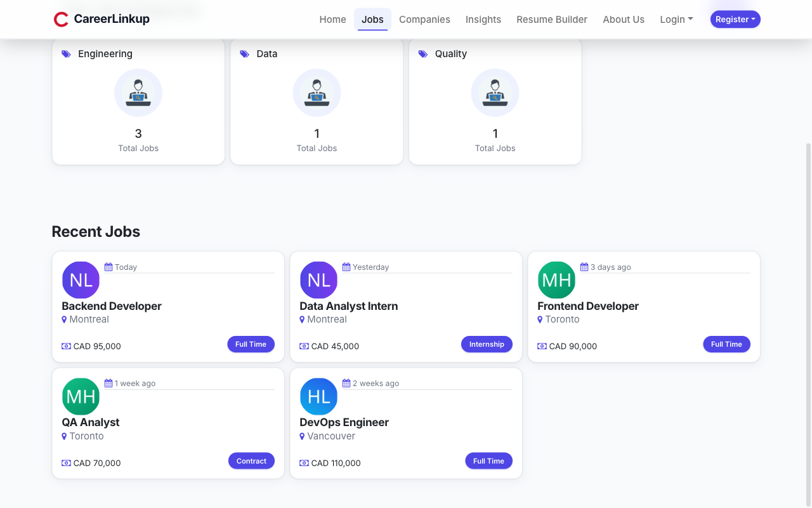
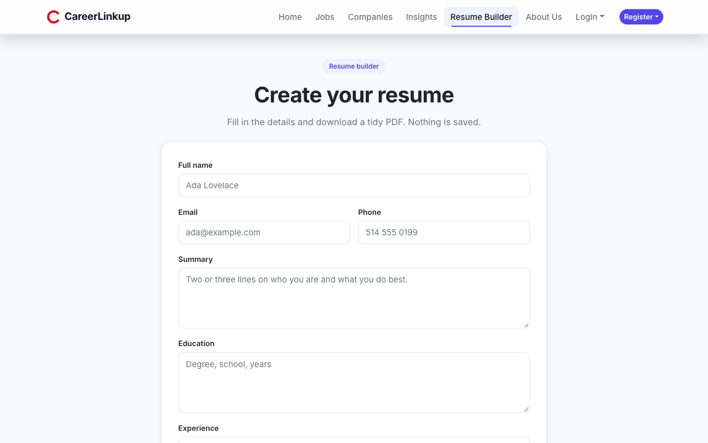
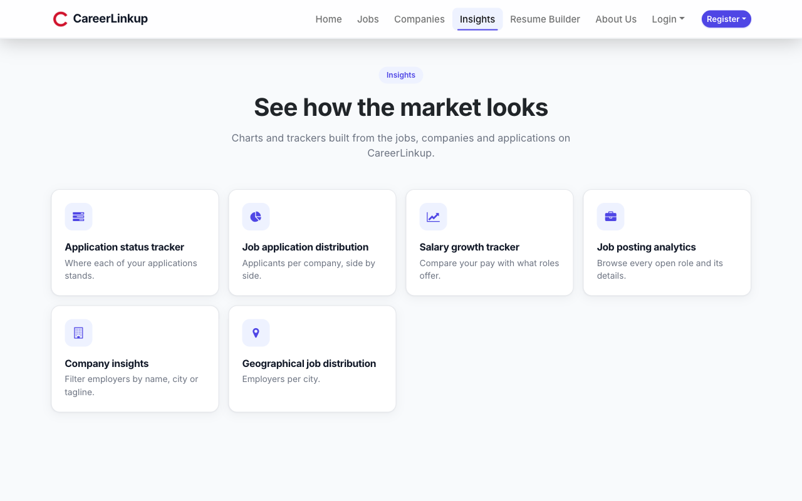
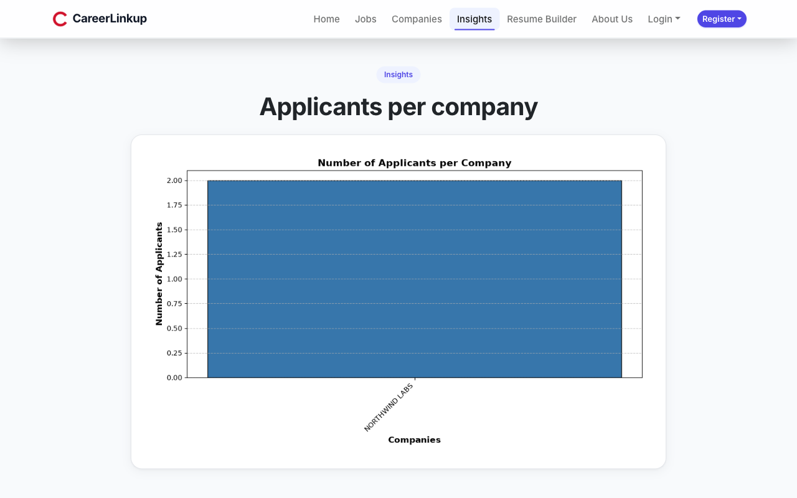
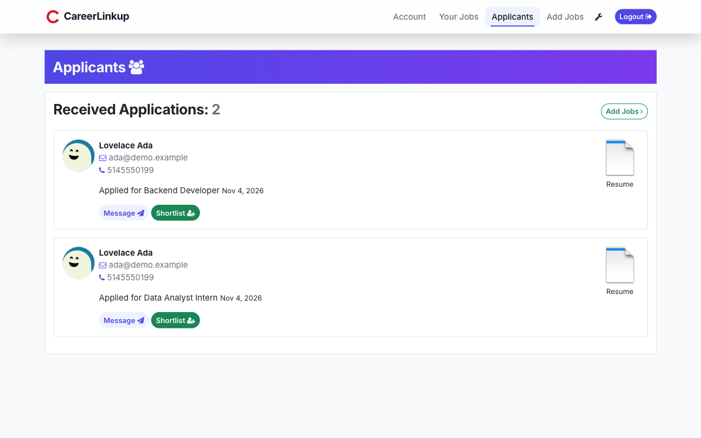
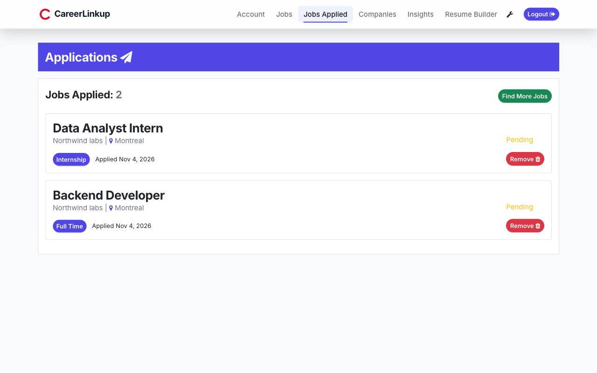
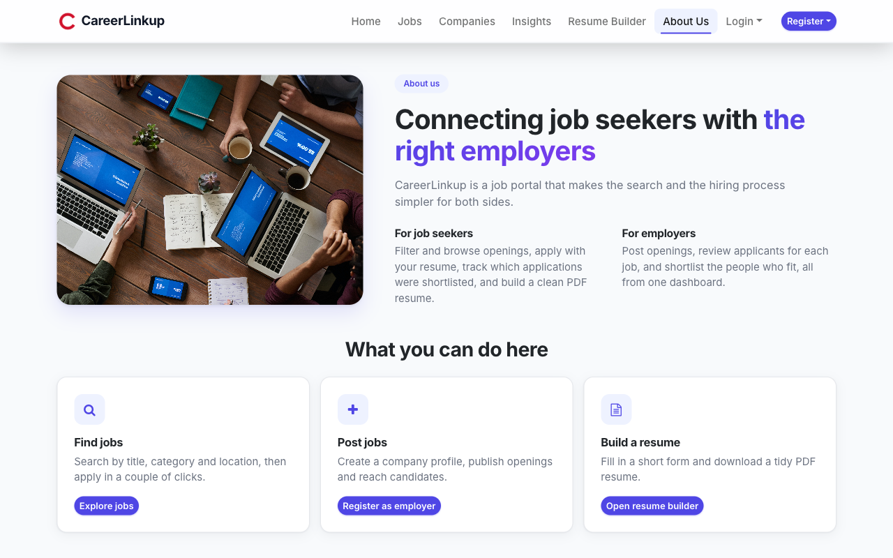
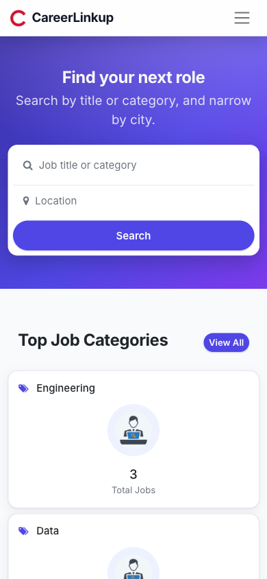
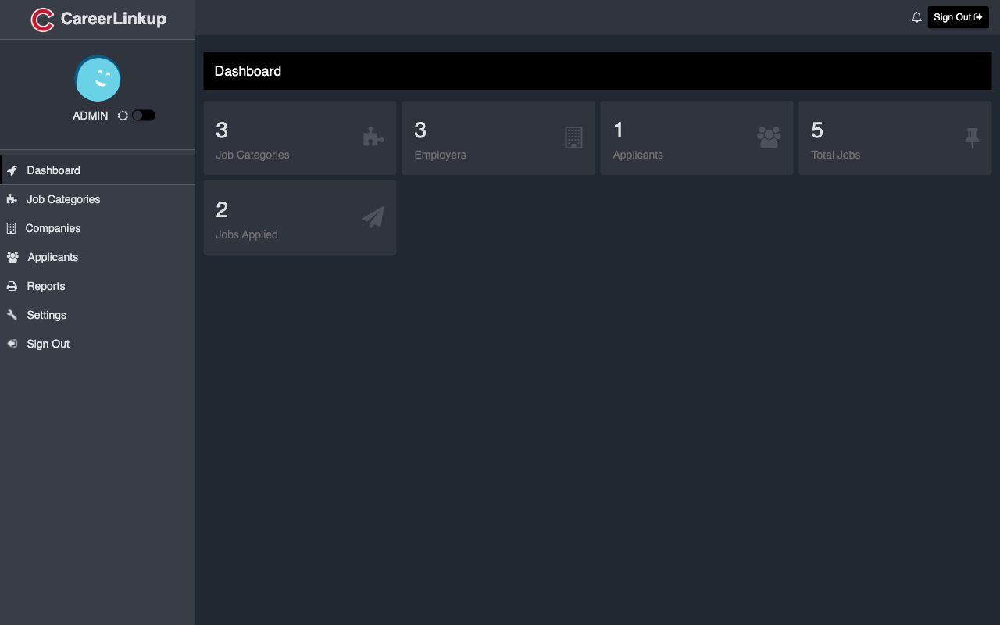

# CareerLinkup

[](https://github.com/rajatjc/CareerLinkup/actions/workflows/ci.yml)

A job board built with Flask. Employers post jobs and shortlist applicants, job seekers apply with a
resume, and admins manage everyone and export reports. Built by a team of six for SOEN 6011 at
Concordia University, summer 2023, and since given a fresh look.



## What it does

| Role | Can |
|------|-----|
| **Applicant** | Sign up with a resume, search jobs by title, category and location, apply, see which applications were shortlisted, withdraw, generate a PDF resume from a form |
| **Employer** | Create a company profile, post, edit and remove jobs, review applicants per job, shortlist them |
| **Admin** | Manage applicants, employers, jobs and other admins; dashboard counts; reports by company, location, job and application, printable as PDF |
| **Anyone** | Browse jobs and companies, filter employers, charts of applicants per company, employers per city and salary growth against your current pay |

All three roles get password reset by email, using signed links that expire after 30 minutes and stop
working once used.

## Screenshots

All of these come from the demo data that `flask --app main seed` creates.

| Search and browse jobs | Resume builder |
|---|---|
|  |  |

| Insights | Applicants per company |
|---|---|
|  |  |

| Employer: received applications | Applicant: jobs applied |
|---|---|
|  |  |

| About | On a phone |
|---|---|
|  |  |

The admin area has its own layout and has not had the new look yet:



## Run it locally

Requires Python 3.12 or newer.

```bash
python -m venv .venv && source .venv/bin/activate
pip install -r requirements.txt
flask --app main seed      # optional: demo companies, jobs and accounts
python main.py             # http://localhost:5002
```

`flask --app main seed` prints the demo logins (all use the password `password123`). On a database with no
admin yet, `/admin/create` makes the first admin account. The seed only runs on an empty database.

### Configuration

Everything has a local default, so none of these are required for development.

| Variable | Default | Purpose |
|----------|---------|---------|
| `SECRET_KEY` | random per process | Signs sessions and reset links. Set it in production, or every restart logs everyone out. |
| `DATABASE_URL` | `sqlite:///mydata.db` (in `instance/`) | Any SQLAlchemy URL |
| `MAIL_SERVER`, `MAIL_PORT`, `MAIL_USE_TLS`, `MAIL_USERNAME`, `MAIL_PASSWORD`, `MAIL_SENDER` | `localhost:25` | SMTP for reset emails |
| `FLASK_DEBUG` | off | `1` turns on the debugger and reloads templates on every change |

Without `FLASK_DEBUG`, templates are cached, so restart the server after editing one.

PDF export of admin reports uses [pdfkit](https://pypi.org/project/pdfkit/), which needs the
`wkhtmltopdf` binary on the path.

### Docker

```bash
docker build -t careerlinkup .
docker run -p 8000:8000 -e SECRET_KEY=change-me -v careerlinkup-data:/app/instance careerlinkup
```

### Deploy on Render

The repo has no Render config file, so set the web service up by hand:

| Setting | Value |
|---------|-------|
| Language | Python 3 |
| Build command | `pip install -r requirements.txt` |
| Start command | `gunicorn main:app` |
| `PYTHON_VERSION` | a 3.12 or 3.13 release. Render's default is far older than this app supports. |
| `SECRET_KEY` | a long random string |

Render auto-deploys on every push to `main`, so a wrong build command fails the deploy as soon as a PR
merges. The previous version keeps running until a deploy succeeds.

On a free instance there is no persistent disk, so the SQLite database and uploaded files are lost at
every deploy and restart. For data that lasts, set `DATABASE_URL` to a hosted database.

On a database with no admin, `/admin/create` makes the first admin account. On a public site that means
the first visitor could claim it, so create your admin yourself as soon as the service starts. Don't run
`flask seed` on a public deployment: it creates demo logins with a published password.

## Tests

```bash
pip install -r requirements-dev.txt
pytest
```

The suite runs against an in-memory SQLite database and covers every public page, login for each role,
signup, password reset, the apply → shortlist → withdraw flow, ownership checks between employers, the
admin pages, the charts, CSRF and the seed command. GitHub Actions runs it on Python 3.12 and 3.13 and
then builds and starts the Docker image.

The tests check behaviour, not appearance. The layout and styling are not covered by them.

## How it's built

```
main.py                  entry point (python main.py or gunicorn main:app)
CareerLinkup/
  __init__.py            app factory: extensions, blueprints, CSRF, template filters
  config.py              settings from environment variables
  models.py              User, Applicant, Employer, Admin, Job and the jobs_applied link table
  forms.py               Flask-WTF forms and validation
  utils.py               uploads, role checks, reset emails, safe redirects
  seed.py                `flask seed` demo data
  routes/                one blueprint per area: main, jobs, applicants, employers, admin, errors
  templates/             base.html holds the navbar; every page extends it
  static/css/theme.css   the current look, layered over the original style.css
tests/                   pytest suite
docs/screenshots/        images used in this README
```

- **Flask** with blueprints, **SQLAlchemy** models on SQLite, **Flask-Login** for sessions, and
  **Flask-Bcrypt** for password hashes.
- **Flask-WTF** for forms. CSRF protection covers every POST, including the JSON employer filter.
- **Matplotlib** draws the charts on the server as PNGs. **ReportLab** builds the resume PDFs.
- Each user row has a role (`applicant`, `employer`, `admin`) and a one-to-one profile. A
  `user_role_required` decorator guards each area.
- **Bootstrap 5** and Font Awesome come from a CDN, so the pages need an internet connection to look right.

### The look

- The navbar is defined once in `base.html`, and the highlighted link comes from the current route.
  Pages do not carry their own copy of the links.
- `theme.css` loads after `style.css` and overrides its colors, buttons, cards and forms with an indigo
  theme. Changing the accent color means editing the variables at the top of that file.
- Job dates read "Today", "3 days ago" or "2 weeks ago" through the `timeago` filter, and application
  dates read "Nov 4, 2026" through `fdate`. Both live in `CareerLinkup/__init__.py`.
- The home page illustration is `static/img/hero.svg`. The demo company logos and the default avatars
  were generated with [DiceBear](https://www.dicebear.com/). Check the licence of the styles you use
  before reusing them elsewhere.

## Team

Team JAN-Soen6011summer2023:

- Arpit Sehgal ([arpit1102](https://github.com/arpit1102)): team lead, backend
- Rajat Sharma ([rajatjc](https://github.com/rajatjc)): backend, hosting, documentation
- Jatish Bhatia ([jatishbhatia](https://github.com/jatishbhatia)): database, backend
- Vikram Singh Brahm ([vikramsinghbrahm](https://github.com/vikramsinghbrahm)): integration testing, UI
- Harika Maddukuri ([harika89](https://github.com/harika89)): UI/UX
- Nandini Bibra ([nandinibibra-96](https://github.com/nandinibibra-96)): database design

`Test cases.xlsx` holds the team's original manual test plan.
